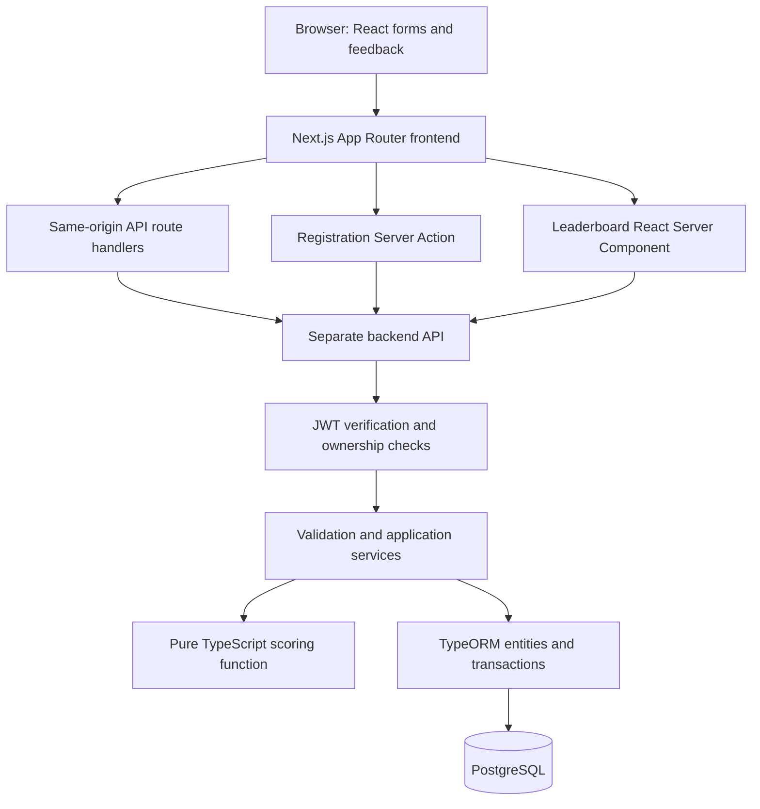
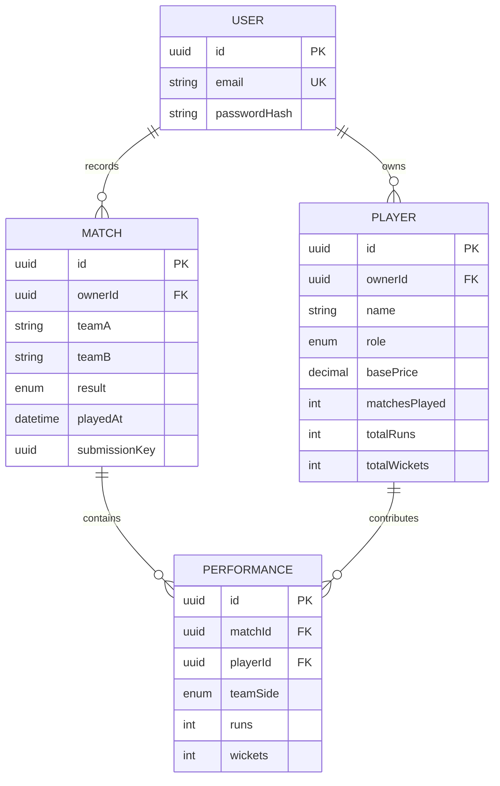
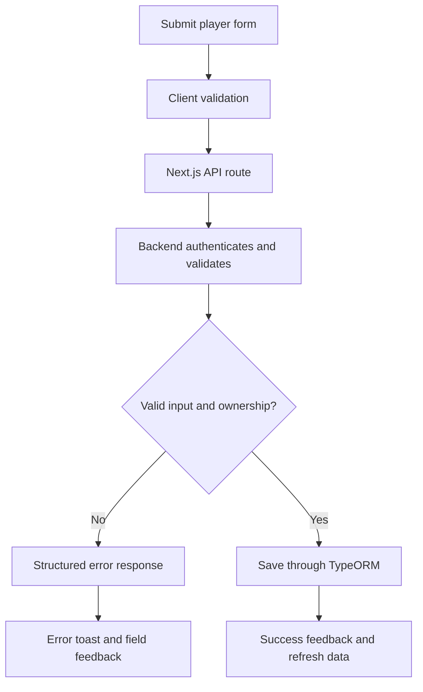
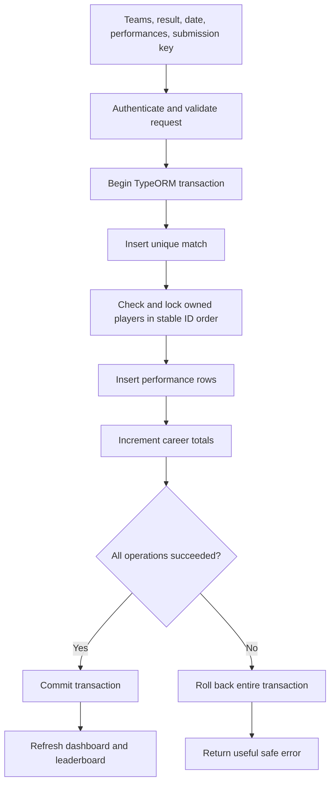
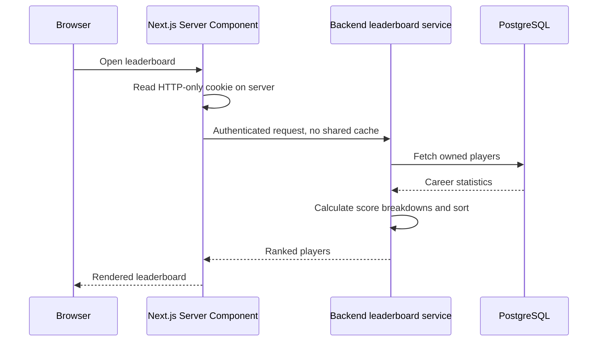

# Criico: architecture, logic, and walkthrough guide

## Implementation status

Frontend and backend source implementations now exist: approved homepage, auth forms, player management, match recording, server-fetched leaderboard, TypeORM schema/migration, and pure scoring function. Unit tests and static checks are being executed. No PostgreSQL connection is configured yet; persistence, migrations, transactions, and full end-to-end behavior must not be described as verified. No production build or deployment has run. Repository READMEs and VERIFICATION.md record setup and limits.

## 1. What we are building

A grassroots cricket management application. An organizer registers, signs in, creates players, records match performances, and sees an explainable Impact Score leaderboard.

Professional scope decision: each organizer owns a separate roster and match history. The homepage is public; management screens require authentication. Team names live on matches initially; full team CRUD is outside the assessment's explicit requirements.

## 2. Separate repository architecture

```text
assignment/
  assignment.md       Original assessment
  logic.md            Architecture and explanation guide
  PRODUCT.md          Confirmed product context
  frontend/           Independently managed Next.js repository
  backend/            Independently managed API/TypeORM repository
```

Do not initialize Git repositories or add remotes until the actual repository workflow is selected. Each application will have its own package.json, pnpm lockfile, environment example, and README. Copy relevant documentation into each repository before submission so it does not exist only in the parent folder.



The browser calls its own Next.js origin. Next.js acts as a thin backend-for-frontend, forwarding explicit allowed requests to the separate backend. Business logic and database access stay in the backend. This avoids cross-domain browser-cookie dependencies and keeps the required Next.js server features meaningful.

Assessment trade-off: the brief names Next.js for frontend/backend. Keeping the required public route handlers and Server Actions in Next.js preserves that interface, but splitting core services into another backend is an architectural departure that must be explained in the README. This split is the user's explicit repository preference.

Backend: Express 5, TypeORM 0.3, PostgreSQL. Frontend: Next.js 15, preserving the explicitly requested middleware.ts convention. Environment names are recorded in each application's .env.example and README.

## 3. Authentication flow

```mermaid
sequenceDiagram
    actor Organizer
    participant UI as Browser
    participant Next as Next.js login route
    participant API as Backend API
    participant DB as PostgreSQL
    Organizer->>UI: Submit email and password
    UI->>Next: POST /api/auth/login
    Next->>API: Forward validated credential request
    API->>DB: Find user
    DB-->>API: User and password hash
    API->>API: Verify password and sign expiring JWT
    API-->>Next: Server-to-server token response
    Next-->>UI: Set HTTP-only cookie; return safe user data
    UI->>Next: Navigate to dashboard with cookie
```

Registration uses a Next.js Server Action, satisfying the mandatory form requirement. The backend validates the request and stores a password hash, never plaintext. A unique database constraint protects email uniqueness even under concurrent registration.

The JWT includes a user identifier and expiry. Verify signature, expiry, and expected signing algorithm. The frontend middleware verifies the JWT before dashboard navigation; the backend independently verifies it on every protected request. Choose an explicitly configured verification mechanism shared between the applications.

The JWT never goes into localStorage or a browser-readable login response. Next.js forwards the session to the backend in a server-to-server Authorization header. Never log cookies, authorization headers, passwords, or tokens. Cookies use HTTP-only, SameSite, Path, and Secure in production. Mutations enforce allowed origin/CSRF protections. Logout clears the cookie; short-lived JWTs limit the exposure of a stolen token, but immediate revocation would require additional session state.

Middleware is navigation protection, not the only authorization boundary. Every backend query is scoped to the authenticated owner ID. Never trust an owner ID from the request body. Server-side user-specific fetches must not share cached data across users.

## 4. Database schema



PostgreSQL fits the relationships and atomic writes. TypeORM maps entities to tables, supplies parameterized queries, and manages migrations and transactions. Use explicit migrations; do not use automatic schema synchronization in production. PostgreSQL decimal prices need deliberate conversion/serialization rather than an unchecked assumption that TypeORM returns JavaScript numbers.

Constraints: nonnegative integer statistics; nonnegative price; one role per player; unique email; unique performance per (matchId, playerId); unique (ownerId, submissionKey). Foreign keys preserve references. Validate that all performance players belong to the match owner.

Career totals may include pre-existing statistics entered when creating a player. Match performances represent matches recorded in this application, so their sums need not equal imported career totals. Manual stat updates are deliberate career corrections; they do not rewrite old match history. Serialize corrections and match increments using consistent row locking/transaction rules to prevent lost updates.

## 5. Player form flow



Negative total runs must show an explicit UI toast, including server-returned validation failures. Browser min attributes alone are insufficient. Validate role, finite numeric values, integers for counts, input lengths, and allowed fields at the server boundary. Do not permit mass assignment of entity fields.

## 6. Record a match atomically



Each participating player gains one match, their recorded runs, and their recorded wickets. Use database increments rather than stale read-modify-write values. All queries inside the transaction use its provided entity manager. Lock affected players in a stable order to reduce deadlock risk.

Reject duplicate players, unknown players, invalid team sides, negative counts, identical team names after normalization, and inconsistent results. A player with zero runs and zero wickets still played a match. Do not invent format-specific limits without a defined match format.

A submission key survives retries of the same form. If the same owner and key arrive again with the same payload, return the existing result without incrementing totals. Reusing a key for a different payload returns a conflict. A unique database constraint resolves concurrent duplicate submissions. Failed attempts must leave no partial match or statistics updates.

## 7. Exact Impact Score

Interpretation: apply role multipliers to the relevant weighted contribution, then apply experience and keeper adjustments. Document this interpretation because the brief's wording is slightly ambiguous.

```text
runContribution = totalRuns × 1.2
wicketContribution = totalWickets × 20

Batsman: runContribution ×= 1.3
Bowler: wicketContribution ×= 1.5
All-rounder: no role multiplier
Wicketkeeper: no role multiplier, add 30

score = runContribution + wicketContribution
if matchesPlayed < 5: score -= 50
if matchesPlayed > 20: score += 100
if role is Wicketkeeper: score += 30
```

Exactly 5 and exactly 20 matches have no experience adjustment. Negative final scores are valid. Never clamp them to zero. A single role enum prevents a Wicketkeeper also having the Bowler multiplier.

Example: Bowler, 4 matches, 100 runs, 10 wickets:

```text
Runs       100 × 1.2       = 120
Wickets     10 × 20 × 1.5  = 300
Rookie adjustment          = -50
Impact Score               = 370
```

Prefer exact hundredth-point integer arithmetic internally (120 per run, 156 per Batsman run, 2000 per wicket, 3000 per Bowler wicket) and divide by 100 for presentation. Validate safe numeric bounds. Sort using the precise score, and format only for display. Define a deterministic tie break, such as normalized name followed by ID.

The scoring function is pure TypeScript, isolated from database and UI code. Return a breakdown alongside the total so the UI and tests can explain the calculation. Calculate on read initially; storing a derived score adds synchronization risk without a demonstrated need at this scale.

## 8. Server-rendered leaderboard



Unlike a single repository application, the Server Component does call the separate backend over HTTP. It does not call its own Next.js route unnecessarily. The client may handle filters or dialogs, but the initial leaderboard fetch stays on the server.

## 9. Public API contract

| Route                 | Responsibility                              |
| --------------------- | ------------------------------------------- |
| POST /api/auth/login  | Authenticate; frontend sets cookie          |
| GET /api/players      | List owned players                          |
| POST /api/players     | Create owned player                         |
| PUT /api/players/[id] | Update an owned player's details/stats      |
| POST /api/matches     | Atomically record match and performances    |
| GET /api/leaderboard  | Return owned players ranked by Impact Score |

Registration is submitted through a Next.js Server Action with a corresponding internal backend operation. Logout also needs a frontend cookie-clearing operation. The brief's “4–5 endpoints” groups multiple methods on shared paths and also requires registration; document necessary auth additions rather than omit them. Deletion is not explicitly requested in the detailed player requirements despite the CRUD heading; defer it to avoid unplanned history-deletion semantics.

Use consistent errors: 400 validation, 401 missing/invalid session, 404 inaccessible/missing record, 409 conflict, and a generic 500 for unexpected failures. Keep internal errors server-side. Add loading, empty, error, and success states.

## 10. Verification plan

Four parameterized score test groups: Bowler with zero matches; high-run Wicketkeeper; exactly 5 and 20 matches; veteran Batsman. Also cover invalid input, ownership isolation, transaction rollback, duplicate submissions, and the negative-runs toast with focused checks appropriate to the implementation.

Initial score/validation unit tests and the negative-runs toast test have executed successfully. Authentication/date-boundary tests are also included. Exact final results belong in repository VERIFICATION.md. PostgreSQL ownership queries, rollback, retry concurrency, migrations, and persistence remain unverified. Player corrections now send expectedUpdatedAt; the backend returns 409 if the locked record changed.

Run relevant unit tests, type checks, and lint scripts once implemented. Inspect desktop and mobile UI, keyboard operation, and reduced-motion behavior. Never claim a check passed without executing it. Do not run a build without explicit user instruction.

## 11. Cricket visual direction

Homepage correction requested by the user: remove the illustrative Bowler/Impact Score statistics band from the public page. Show real owned-player statistics and score breakdowns inside the dashboard and leaderboard. Keep public content focused on the introduction, player management, match recording, leaderboard explanation, and account entry. Revised concept: `.impeccable/mocks/home-a-pavilion-clean.png`.

Typography decision: Plus Jakarta Sans throughout, replacing the initial serif concepts and the later suggested Barlow Condensed/Inter pairing. Use distinct weights and tabular numerals for hierarchy. The actual font must be loaded in implementation; generated mockups cannot verify an exact font file.

User selected a pavilion-inspired identity and generated design concepts before code. Warm cream and deep green, scoreboard-inspired numeric typography, legible tables, and restrained cricket motion. Animation must respect reduced-motion preferences and should not interfere with forms. Example data must be labeled demo data. No fabricated customer counts, testimonials, or endorsements.

Brand update supplied by the user: Criico Sports Technologies Pvt. Ltd.; "Building Grassroot Cricket Community of Nepal"; tagline "Cricket. Community. Together."; website https://www.criico.com/. Use exact crimson `#DC143C` as the primary brand accent, with cream and cricket green supporting it. The initial concept images use an approximate red; implementation and future concepts must use the updated crimson. Color usage remains subject to accessible contrast checks.

The supplied HR email and phone are recruitment context, not application support contacts. The email signature's Gmail image link has not been retrieved and is not a usable local logo asset. These brand facts were supplied by the user and have not been independently verified.

## 12. Video walkthrough plan (3–5 minutes)

1. Show the organizer workflow and repository boundaries.
2. Explain User, Player, Match, and Performance relationships and PostgreSQL transactions.
3. Explain HTTP-only JWT cookies, middleware, backend checks, and ownership.
4. Walk through the actual scoring function and boundary tests.
5. Demonstrate one genuine development bug, its fix, and verification.

Keep a factual bug log during development. Do not invent a bug or fake Git history. Commit real working increments. Explain assumptions, trade-offs, and any unfinished work honestly.
