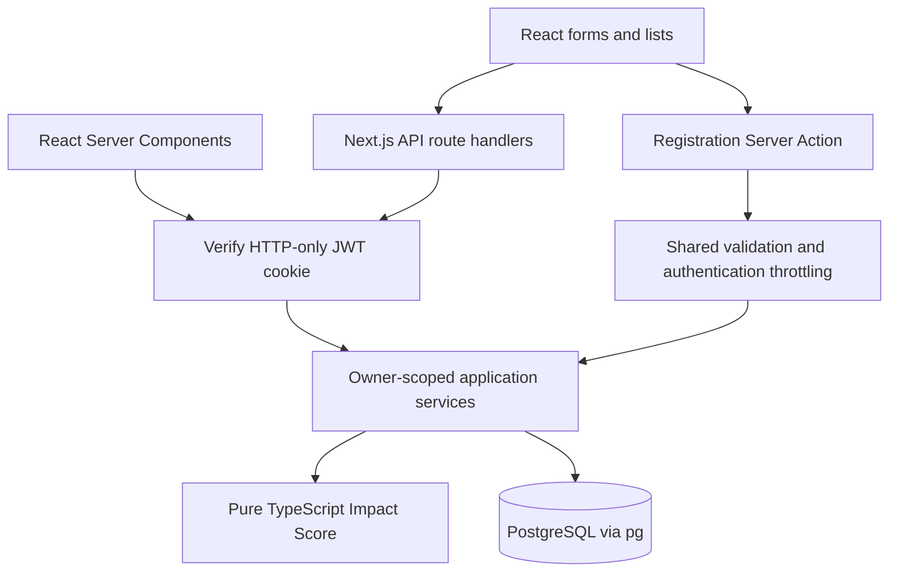
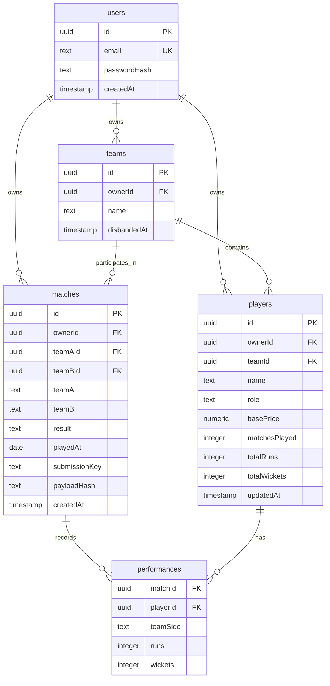

# Criico: implementation and walkthrough guide

## Current architecture

One full-stack Next.js 15 App Router application. Route handlers and Server Actions call shared server-side services; PostgreSQL access uses parameterized queries through pg. There is no separate Express process and TypeORM is not used.

Backend code is grouped by domain under `src/lib/services/`: authentication, players and leaderboard, teams, matches and dashboard reads. `services.ts` is only a compatibility export for tests and older imports. API route handlers import their domain service directly; Server Components use the authenticated helpers in `backend.ts` and call those services without making an HTTP request back into the same app.

## Database schema and relationships

The database is relational PostgreSQL. Every application record is scoped to an
organizer through `ownerId`, which is the authenticated user's ID. The main
relationships are:

### Table responsibilities

| Table | Purpose | Important relationships |
| --- | --- | --- |
| `users` | Organizer accounts and password hashes | One user owns teams, players, and matches |
| `teams` | Organizer-owned cricket teams | A team contains many players and can participate in matches |
| `players` | Roster members and career totals | A player belongs to an owner and optionally a team |
| `matches` | Completed match metadata | A match belongs to an owner and references two teams |
| `performances` | Per-player match statistics | Joins one match to one player with runs, wickets, and team side |

`performances` is the linking table between `matches` and `players`. This keeps
historical match data separate from the denormalized career totals stored on
`players`. When a match is recorded, the application inserts the match,
inserts its performances, and increments the affected players' career totals
inside one transaction.

The application also keeps the team names on `matches` as historical display
values. That means a later team rename does not change how an old match is
displayed. `submissionKey` and `payloadHash` make retries safe: an identical
retry returns the existing match, while the same key with different data is
rejected.

## Authentication

Registration uses a Server Action and the same credential schema as API registration/login: at least eight characters, at most 72 UTF-8 bytes. A bcrypt hash is stored, never the password. JWTs are signed with a required random environment secret and expire in eight hours. They are returned only in an HTTP-only cookie, never JSON or localStorage. The cookie is Secure in production and SameSite=Lax.

Middleware protects dashboard navigation; server data helpers and API routes independently verify sessions. All services scope queries by the authenticated owner ID. Browser mutations require a matching Origin; server actions additionally use Next.js's built-in origin checking. Authentication attempts are limited per normalized email within each Node process; multi-instance production needs an atomic shared rate-limit store.

Database connections use encrypted TLS transport. Certificate verification is disabled for compatibility with the assignment database provider.

## Tables and transactions

User owns Players and Matches. Performance links one Player to one Match, with its team side, runs, and wickets. A match stores team names, outcome, Nepal calendar date, and an owner-scoped submission key plus canonical payload hash.

Recording a match inserts the match, locks all owned participants in ID order, batch-inserts their performances, and batch-increments career totals in one transaction. Database round trips for recording a match stay constant as the number of players increases. A zero-stat participant still gains one match. Invalid participants or overflow roll back the transaction. Stable lock ordering reduces deadlock risk; it is not a claim that every possible deadlock is impossible.

The dashboard reads its summary, top run scorers, top wicket takers, and recent matches in one PostgreSQL round trip. Owner-scoped indexes support common player sorting, the default Impact Score order, and recent match history. The dashboard disables speculative route prefetch so the browser does not load several large RSC pages before the organizer opens them.

Retrying an identical submission key/payload returns the existing result without incrementing statistics. A different payload with that key returns 409. A unique database constraint resolves concurrent duplicate submissions.

Player updates require the originally loaded expectedUpdatedAt timestamp. PostgreSQL timestamps are formatted with full microsecond precision; the locked current value must match. Player deletion is rejected if any match performances reference the player, preserving history. Existing career statistics can include matches before this app; manual career corrections do not rewrite historical performances.

## Pagination

GET /api/players and /api/leaderboard accept page, limit, search, and role. GET /api/matches accepts page and limit. Responses are { data, meta }, with page, limit, totalItems, totalPages, hasNextPage, hasPreviousPage, nextPage, and previousPage.

Defaults: page 1, limit 20; maximum limit 100. Invalid/repeated pagination parameters return 400. Empty lists report page 1, totalPages 0, null next/previous pages. Requests beyond the final page normalize to the last available page.

One SQL statement takes a consistent snapshot for counts and page selection. Filters apply across the owned dataset before pagination. Ordering includes ID as a final tie breaker. Leaderboard sorting evaluates the exact score in SQL before slicing; the TypeScript function still produces the returned breakdown. Tests must check their agreement. Ties use lowercase name in PostgreSQL C collation, then ID.

URL-backed controls preserve filters and reset page when filters or page size change. Dashboard summaries use aggregate counts/sums, not page lengths. Match recording fetches lightweight player options independently of list pages; editing fetches a single owned player directly.

## Impact Score

Runs ? 1.2, with an extra ? 1.3 for Batsmen. Wickets ? 20, with an extra ? 1.5 for Bowlers. Fewer than 5 matches: ?50; more than 20: +100. Wicketkeeper: +30 and no role multiplier. Exactly 5 and 20: no adjustment. Negative totals are valid.

The TypeScript function calculates integer hundredths, then converts for presentation. Example: Bowler, 4 matches, 100 runs, 10 wickets ? 120 + 300 ? 50 = 370. One role enum prevents combined Bowler/Wicketkeeper roles.

## UI and verification

The public homepage uses the approved cricket ground, cream/forest palette, crimson #DC143C, and self-hosted Plus Jakarta Sans. Detailed scores stay in the private dashboard/leaderboard. Negative total runs produce a Sonner error toast and abort saving. Loading, empty, validation, success, conflict, and service-error states are included.

pnpm test runs database-independent tests by default. Database-writing integration tests are opt-in via a dedicated TEST_DATABASE_URL and reject the configured application database. They invoke route handlers directly; they are not browser end-to-end tests. The read-only database check is separately opt-in.

Production build and deployment require separate verification. No build has been run during this fix task.